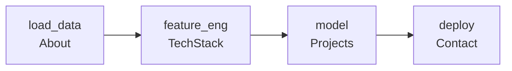

### 📓 `rafli.ipynb`
<sub>Kernel: Python 3 (data-science) · ● Idle</sub>

---

`In [1]:`
```python
from sklearn.pipeline import Pipeline
from rafli import About, TechStack, Projects, Contact
```

`In [2]:`
```python
rafli = Pipeline([
    ("load_data",   About()),      # who I am
    ("feature_eng", TechStack()),  # what I use
    ("model",       Projects()),   # what I build
    ("deploy",      Contact()),    # where to find me
])
rafli
```

`Out[2]:`


---

`In [3]:`
```python
rafli.named_steps["load_data"].info()
```

`Out[3]:`
```text
<class 'rafli.About'>
name     : Rafli
role     : Aspiring Data Scientist
focus    : Machine Learning · Computer Vision · NLP · Time Series
status   : open to collaborate
```

---

`In [4]:`
```python
rafli.named_steps["feature_eng"].get_feature_names_out()
```

`Out[4]:`


---

`In [5]:`
```python
rafli.named_steps["model"].projects.head()
```

`Out[5]:`

|   | project | task | highlights |
|---|---|---|---|
| 0 | [tokopedia-user-reviews-insights](https://github.com/rafli-1729/tokopedia-user-reviews-insights) | NLP · RAG | 5 years of Play Store reviews, sentiment trends, semantic search |
| 1 | [semi-supervised-food-classification](https://github.com/rafli-1729/semi-supervised-food-classification) | Computer Vision | CNN fine-tuning + DINOv2 embeddings, iterative pseudo-labeling |
| 2 | [cross-modal-rainfall-prediction-system](https://github.com/rafli-1729/cross-modal-rainfall-prediction-system) | CV · Time Series | image-based data extraction + gradient boosting |
| 3 | [health-insurance-charges-analytics](https://github.com/rafli-1729/health-insurance-charges-analytics) | Regression | XGBoost, LightGBM & DNN, feature importance |
| 4 | [indonesian-heritage-classification](https://github.com/rafli-1729/indonesian-heritage-classification) | Computer Vision | fastai + PyTorch + timm, traditional Indonesian houses |

---

`In [6]:`
```python
rafli.named_steps["deploy"].endpoints
```

`Out[6]:`
```text
{'email':     'rafli.4lyfe@gmail.com',
 'github':    'github.com/rafli-1729',
 'portfolio': 'rafli-1729.github.io'}
```

---

`In [ ]:`
```python
# rafli.fit(new_data)  → still training...
```
